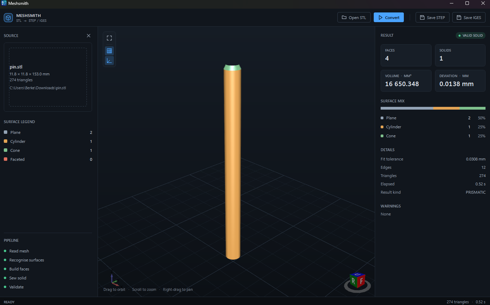

# Meshsmith

An offline **STL → STEP / IGES** converter for mechanical parts. It reads a triangle mesh, finds the
analytic surfaces inside it (planes, cylinders, cones, tori, spheres), trims and sews them into a
solid, and writes an editable STEP AP214 or IGES 5.3 file.

No network, no server, no account. The same input gives the same output, and every export is read back
from disk and checked before the app calls it a success.



## Status

- **0.1.4**, Windows desktop app (WPF, .NET 8) with a headless CLI and an isolated conversion worker.
- **6 of 6** real test parts convert to a valid solid; 0 crashes.
- `Meshsmith.Core` 99 tests, `Meshsmith.App` 140 tests.
- **R1.2**, measured through the CLI: IKI KATLI MONT P1 and Part 2 now export **2,024 faces** (was
  2,784) as 8 solids at 96.8 % analytic coverage, `artifact=verified`; `pin.stl` is unchanged at
  4 faces, valid.
- **R1.3**, measured through the CLI: `clamp.stl` now exports **4,444 faces, `valid=True`,
  `artifact=verified`, exit 0** (33.6 % coverage — every clamp body is faceted, so the face count is
  the fallback's). The faceted body was never the problem: its exact 5,076-triangle shell is a valid
  solid, and `ShapeUpgrade_UnifySameDomain` was turning it into an invalid one by merging a coplanar
  jaw region that is not a disc. `SolidBuilder` now verifies the merge and repairs it with
  `ShapeFix_Shell`, keeping the exact facets if that also fails.
- **R3**, measured through the CLI: a synthetic **two-torus** part (2 bodies, 8,192 triangles) now
  classifies **100.0 % as torus** with `faceted=0`, and exports **4 faces, 2 solids, `valid=True`,
  `artifact=verified`** — exact volume 3,553.06 mm³. Tori are fitted *after* cone (a sphere fit
  accepts a cylinder and a cone exactly, so trying it earlier drops `pin.stl` from 100 % to 32.5 %)
  and the sphere fit carries a latitude guard, because two concentric circles are exactly a sphere.
  No real part moved: `pin.stl` 4 faces / 100 %, `clamp.stl` 4,444 / 34.3 %,
  `IKI KATLI MONT P1` 2,024 / 96.8 %, `IKI KATLI MONT` 7,266 / 99.2 %, `ATLAS` 935 / 64.7 %.
- **R3, the honest half:** `clamp.stl`'s 3,372-triangle leftover is **not** a torus, not a sphere and
  not a surface of revolution about *any* axis — the best of 2,000 candidate axes leaves a
  meridional residual of 7.96 mm against a 0.012 mm tolerance (666×), and an unconstrained torus fit
  over 500 axis starts bottoms out at 10.75 mm. Clamp's coverage half of the R1 gate is therefore
  **not reachable** by adding primitives; it needs segmentation work, not a new surface.
- **R2**, measured through the CLI: the leftover region now gets a **second chance** — the residual is
  re-grown at 20°, refitted with exactly the rule the primary seeds use, and split 12/6/3 where the fit
  still fails, behind a 16-triangle floor and a **monotone acceptance rule** (a piece is kept only if
  its fit keeps at least as many triangles as the piece takes from analytic regions), so coverage
  cannot fall. `ATLAS` **64.7 → 79.0 %** (935 faces, `valid=True`, `artifact=verified`, exit 0),
  `clamp.stl` **34.3 → 55.4 %** (4,444 faces, `valid=True`, `artifact=verified`, exit 0), and the
  in-repo witness `fixtures/clamp_body0.stl` **33.9 → 57.9 %**. Nothing else moved: `pin.stl` 4 faces /
  100 %, `IKI KATLI MONT P1` 2,024 / 96.8 %, `IKI KATLI MONT` 7,266 / 99.2 %, the washer fixture
  4 faces / 100 %, the 64×32 two-torus 100 %.
- **R2, the honest half:** **the knob is not recognised by segmentation** — its classifier already
  returns one 369,852-triangle region (96 % of the mesh), and the split ladder only turns that into
  5,091 regions at **40.5 %** "coverage" (154,256 of the 156,522 gained triangles are planes), so it
  needs a primitive-hypothesis segmenter, not a grower. The coarse two-torus fixtures are unchanged at
  **33.3 %** (`24×12`, `48×24`) and **0 %** (`32×16`): `24×12` cannot fit at the pipeline tolerance for a
  tessellation reason, and `48×24` loses a third of each body to a bogus `cone`.

## Requirements

- Windows 10 or 11, 64-bit
- .NET 8 Desktop Runtime (the app is framework-dependent)

## Build

```bash
dotnet build Meshsmith.slnx
dotnet test
```

Run the app: `src/Meshsmith.App/bin/Debug/net8.0-windows/Meshsmith.App.exe`
Run the CLI: `src/Meshsmith.Cli/bin/Debug/net8.0-windows7.0/Meshsmith.Cli.exe convert part.stl -o part.step`

The OCCT native payload is copied next to the executables by the build; nothing else needs installing.

## How it works

1. **Read and weld** the STL into a shared-vertex mesh, then repair it (degenerate triangles, exact
   duplicate faces, winding, holes on manifold surfaces). Every change is counted and reported.
2. **Classify** the mesh into regions and fit a primitive to each (plane, cylinder, cone, torus,
   sphere).
3. **Build** trimmed OCCT faces for the regions and **sew** them into a solid. If the analytic body does
   not close, the exact faceted solid is exported instead and the reason is reported.
4. **Write** STEP and IGES, then **read the file back** and compare face count, volume and validity.
   The checked file decides whether the conversion succeeded.
5. On any failure, write a diagnostic bundle (`%TEMP%\meshsmith-diag-*.zip`: error text, model, log
   tail) and show it on the error card.

The conversion runs in a separate worker process, so an OCCT crash cannot take the window down.

## Project layout

```
src/Meshsmith.Core     mesh, fitting, B-Rep building, exporters, verification
src/Meshsmith.App      WPF shell, view models, services
src/Meshsmith.Worker   the child process that owns the pipeline
src/Meshsmith.Cli      headless conversion
tests/                 Core and App test suites
fixtures/              small STL fixtures used by the tests
tools/                 corpus runner and other development scripts
HANDBOOK.md            engineering notes: pipeline, lessons, measurements
```

## Known limits

- The STL is read before the busy state appears; cancelling during that read is not possible yet.
- A part that needs the faceted fallback produces a large STEP (one face per triangle) and its surfaces
  are not editable as cylinders.
- Models above ~100k triangles are outside the tested envelope (they work, but slowly and with a large
  memory footprint).
- One conversion at a time; STEP AP214 and IGES 5.3 only.

## Third-party

- [OCCT](https://dev.opencascade.org/) via [Occt.NET](https://www.nuget.org/packages/Occt.NET) — LGPL 2.1
  with exception; shipped as separate native libraries.
- [HelixToolkit.Wpf](https://github.com/helix-toolkit/helix-toolkit) — MIT.

## License

**Source-available, free to use — not free to sell.** MIT, plus the
[Commons Clause](https://commonsclause.com/) condition:

- ✅ **Use it for anything, including commercial work.** Run it in your shop, in your company, on
  client parts, in your own products; modify it for your own use.
- ✅ **Share it**, with the licence attached.
- ❌ **Don't sell it** — not the app, not a bundle containing it, and not a paid service whose value
  derives substantially from Meshsmith itself.

That last line is the whole point: this is a tool for people who make things, not a product for
someone else to resell. It is *source-available*, not OSI "open source" — the phrase means exactly this
kind of restriction.

Third-party components keep their own licences (OCCT is LGPL 2.1 with exception; HelixToolkit is MIT)
and are not covered by the above.
